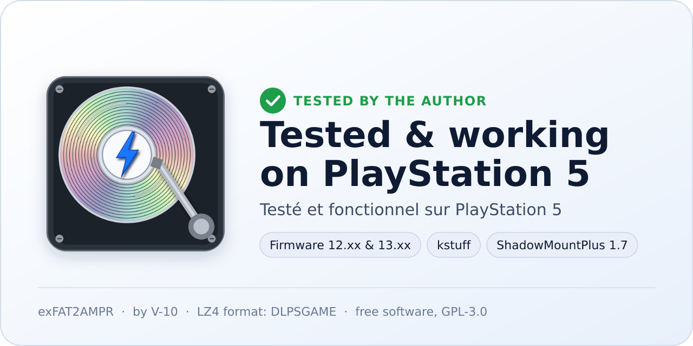

# exFAT2AMPR

**Convertit vos jeux PS5 au format AMPR LZ4, directement sur la console.** Pas de PC : on choisit le jeu à la
manette, l'app le compresse et le range où vous voulez (SSD interne, SSD M.2 ou disque USB).

✅ Testé et fonctionnel sur PS5 par l'auteur (firmware 12.xx et 13.xx, kstuff, ShadowMountPlus 1.7).

## Ce que ça apporte

- **Des jeux plus légers** : jusqu'à moitié moins de place, selon le jeu (certains, déjà compressés, ne gagnent
  presque rien ; l'app estime le gain avant de commencer).
- **Tout se fait sur la console**, en arrière-plan, même pendant que vous jouez.
- **Rien n'est perdu** : chaque bloc est vérifié, une conversion interrompue (coupure, mode repos, disque plein)
  reprend où elle s'était arrêtée, et le jeu d'origine est gardé (sauf si vous demandez sa suppression).

## Ce qu'il faut

- Une PS5 jailbreakée avec **kstuff**.
- Un chargeur d'ELF sur le port 9021 (elfldr, etaHEN…).
- **ShadowMountPlus 1.7** ou plus récent.

## Installation

1. Copiez `PPSA99272.ffpkg` (page *Releases*) dans `homebrew/` à la racine d'une clé USB exFAT, ou par FTP dans
   `/data/homebrew/`. **Une seule copie.**
2. Redémarrez la console et lancez le jailbreak : **exFAT2AMPR** apparaît sur l'écran d'accueil.
3. Ouvrez l'app. Elle démarre son moteur toute seule.

Les mises à jour s'installent ensuite depuis l'app : **Réglages › Mises à jour**.

## Utilisation

1. Choisissez un jeu (□ pour en cocher plusieurs).
2. ✕ : options, puis destination, puis vérification avant le lancement.
3. La conversion tourne seule. Suivez-la dans l'onglet **Progression** (L1/R1 pour changer d'onglet).

Le jeu converti apparaît sur l'écran d'accueil grâce à ShadowMountPlus.

Le bouton **OPTIONS** sur un jeu ouvre son menu : optimiser, mettre à jour ses plugins, **réparer** un jeu
converti, **mettre de côté** une image en double, supprimer une copie, réglages.

Aussi depuis un téléphone ou un PC : la page web du moteur (adresse affichée dans l'app, port 6972, appairage
par code ou QR code).

## Bon à savoir

- **Gardez le jeu d'origine** tant que vous n'avez pas lancé la version convertie au moins une fois. Certains
  jeux ne fonctionnent pas une fois convertis (c'est le cas de jeux faits avec Unity, par exemple).
- L'app refuse de convertir un jeu qui n'utilise pas AMPR, et ne remplace jamais un dossier qui n'est pas un
  jeu converti.
- Un problème ? **Réglages › Diagnostic** crée un fichier à joindre à votre message (code d'appairage et adresse
  masqués).
- Langues : français, anglais, espagnol, italien, russe, portugais, chinois, thaï, vietnamien (plus l'arabe sur
  la page web).

Détails techniques (format, pause et reprise, profils, compilation) : [docs/TECHNIQUE.md](docs/TECHNIQUE.md).

## Crédits

- **V-10** : auteur d'exFAT2AMPR.
- **DLPSGAME** : le format LZ4 des jeux PS5.
- **drakmor** : l'émulateur AMPR (ampr_emu), ShadowMountPlus, pgo_stub et dlc_emu.
- **Yann Collet** : l'algorithme LZ4.

## Licence

exFAT2AMPR - Copyright (C) 2026 V-10. Logiciel libre sous GNU GPL version 3 ou ultérieure (`COPYING`), avec des
conditions supplémentaires (`NOTICE`) :

- toute copie ou version modifiée garde ce copyright et le crédit « Créé par V-10 » ;
- une version modifiée se présente comme modifiée et ne se fait pas passer pour l'originale ;
- le nom « exFAT2AMPR » et son logo ne sont pas cédés : une version modifiée diffusée porte un autre nom et une
  autre icône.

Retirer le nom de l'auteur ou diffuser le programme sous un autre nom d'auteur met fin aux droits accordés par la
licence (article 8). Composants tiers : drakmor/ampr_emu (GPL-3.0), LZ4 (BSD-2), ps5-payload-sdk (GPL-3.0), polices
DejaVu Sans, Noto Sans Thai et Noto Sans CJK (SIL OFL 1.1).
